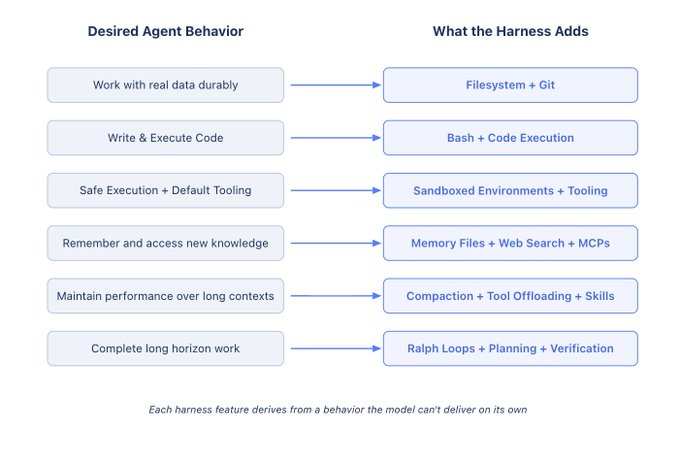
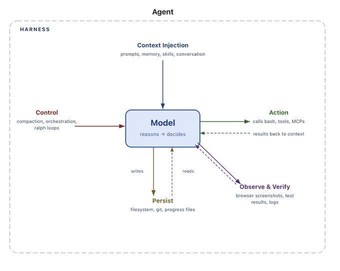

# Prerequisites

QR Code with reference meetup repo

Prerequisites:

1. Clone repo
2. Install python (see uv instructions in README.md)
3. No typing expected during the talk, use scripts in repo or watch me do it and then try it out at home at your own pace using agentic harness as a guide and tutor

# Agenda

1. What is an Agent?
2. What is a Harness?
3. What's under the hood of a coding harnesses?
4. Existing harnesses like pi, OpenCode

# Long-Term Agenda

1. (today) Agent Foundations: Agent Loop + Basic Tools
2. More harness featueres: skills, MCP, hooks
3. Agent Memory & Search
4. Subagents and Loops
5. Harness internals - compaction, sandboxes, llm tokenomics
6. Agent tooling - observability, integrations
7. Benchmarks deep-dive - how terminal bench works
8. Self-improving agents e.g. Hermes, OpenClaw
9. Dark Factories and future of work

# LLMs Basics

- LLMs are neural networks
- Neural networks are machine learning models trained on data to predict something
- LLMs are trained on a internet-scale corpus of text to predict the next word (token)
  > Example: "Hello my name \_" -> predict: "is"
- That means that LLMs can only take in text and continue it (not discussing multi-modal now)
  > Text In -> LLM -> Text Out
- LLMs are stateless, they just continue whatever input you gave them

# Different LLM Providers

There are many LLM providers. Main tradeoff is between

1. Intelligence - bigger models are usually smarter and perform better with fewer prompts
2. Cost - smaller models are cheaper but also many providers subsidise tokens to attract users
3. Speed - smaller models provide results faster
4. Availability - the more infra provider has the better the availability (e.g. Kimi/Deepseek was hard to use because a lot of demand and few servers)

Each model offers a different configuration in that space. So, different models will be better suited for different tasks.

https://artificialanalysis.ai/ - LLM comparison platform

Each provider has its own API (URL) for using the model.

Routers offer a common interface to many providers allowing to easily switch between models based on your task at hand.

We'll use [Openrouter](https://openrouter.ai/) as example here. Let's generate API key and put it into .env file, so we can do our first API call

# Simple LLM API call

Let's now try running a simple LLM call via Openrouter API

You'll need

```bash
cd 1_agent_loop/src
```

```bash
uv run llm_call.py "What is an AI Agent?"
```

That's cool. However, there are several problems right away.

1. All model can tell us is based on the knowledge in the LLM training corpus.
2. Model doesn't remember between invocations

Examples:

If we ask it what's the weather like in Munich it won't be able to answer because it was trained in the past and we're asking it about current weather.

```bash
uv run llm_call.py "What is the weather like in Munich today?"
```

Model is stateless and doesn't persist memory between calls

```bash
uv run llm_tool_call.py "What did we discuss before?"
```

# Tool Calling

Let's first deal with LLM inability to tell us current weather. The insight is that there are APIs available that can fetch weather data, so can we make LLM call this API?

LLMs output only text but they can output structured text

```sh
uv run llm_call.py "Output only json with keys 'location': 'Munich', date: '31.07.26'"
```

It produces json that we can parse and pass as the function input in our code. This ability to produce structured response is built into many LLM APIs via `tool` parameter where we pass a list of tools available to the model similarly to how we pass a list of messages to `message` parameter.

Now we let the model decide when to call a weather tool:

```bash
uv run llm_tool_call.py "What is the weather in Munich right now?"
```

The model returns a structured `get_weather` tool call. Our code sends one
request to the free wttr.in API and returns the current weather.

We've just extended the abilites of the model (LLM) with an API call. Harness added something model couldn't do out of the box and there are many other things we can add to extend the model capabilities. That's harness engineering

# Message history

Tool result is not looking nice. What if we pass the tool result back to the model instead of just displaying it?

// uncomment the messages array

Now we've introduced message history by appending messages and tool results to a list of messages and passing it to the model. Now the harness around the model is keeping state. Note that the model itself doesn't - it just sees a new full messages list and outputs result.

This new request with updated message history can go to another GPU cluster than previous request and the model there will be able to handle it. Model statelesness allows model providers to scale horizontally.

# Multi-Turn

The issue with our setup right now is that model doesn't retain memory between calls. If I ask the model in a new call what did we discuss before it won't remember because model itself is stateless and doesn't keep memory between invocations

```sh
uv run llm_tool_call.py "What did we discuss before?"
```

However, we can fix it by appending previous user messages and agent replies to the message list and passing this ever-growing list to the model. We'll use a never-ending while loop to do it, so our conversation can go on turn after turn.

```bash
uv run llm_multiturn.py
```

# Context window and Caching

Even with a while loop our conversation can't go on ad infinitum. Eventually LLM will "run out of memory". LLMs have "Context Windows" of different sizes which dictate how many tokens can fit in. For english it's usually considered 4 characters per token. Most models have either around 200k or 1mn tokens context window nowadays

Token costs are different for input tokens and output tokens with input tokens being much cheaper than output tokens

https://openrouter.ai/openai/gpt-5.6-luna

However, we don't pay full read price for all messages sent to the model with each invocation. Model providers cache input tokens on their side and cached tokens cost much less than new read tokens. However, for tokens to be cached the message history mush be exactly the same as before. If I change a single character in a first message the whole cache will get invalidated and we'll incur a full cost for the whole message history. We will discuss more about how to save on your tokens in a future discussion on LLM tokenomics.

# System Prompt

We've seen user and assistant messages but there is also a special `system` prompt which model is trained to strictly adhere to. For example, if system prompt says speak like a pirate the user message can't undo that.

# From LLM to an Agent

Now that we've seen message loop and tool calling we're ready to turn our LLM into an Agent. Agent is basically an LLM that can do meaningful work. For knowledge work meaningful usually means that we process (read) some information (text) and turn it into another form of information (another text). Therefore, to do meaningful work our agent must be ideally able to read files, write files, execute files (if they're code) and fetch data from external sources (the web).

# Almost everything can be done via terminal commands

Everything in knowledge work is about text

The terminal is a text interface to your computer. APIs are text interfaces to other computers.

With the right **permissions**, commands can read data, change data, run programs, and ask services to do work.

```bash
# Read a local file
cat src/llm_call.py

# Create and read a local file
echo "What is an AI Agent?" > question.txt
cat question.txt

# Ask a computer on the web for information
curl -sL "https://en.wikipedia.org/api/rest_v1/page/summary/Alan_Turing" \
  | jq -r '.extract'
```

The LLM command above is one more example: it sends a request to an external service and prints the response.

So, if we give our LLM ability to execute arbitrary commands it will be able to pretty much do anything with the computer.

All of those terminal commands are essentially functions similar to the weather function that we've seen before. Let's turn our LLM into an Agent now

# Agent Loop

Let's give our agent ability to execute bash commands.

Our agent has one general-purpose tool: it can run Bash commands. The model chooses a command, our harness runs it, and the command output goes back to the model for its next decision.

WARNING! This agent seems simple and cute but it's incredibly powerful and dangerous - it can completely wipe out your computer, steal your credentials from .env and do all kinds of damage. It's for illustrative purposes only and shouldn't be used as agent for doing work

```sh
uv run simple_agent.py "Create and run a fibonacci python algorithm in $PWD for n = 10"
```

For a multi-turn version that keeps the full conversation history:

```bash
uv run simple_agent_interactive.py
```

The script asks for confirmation before each command. This matters because a command tool has the same permissions as the person running the script.

This is the famous Agent Loop from the ReAct paper that is the backbone of all of the agents you've heard about - Claude Code, Codex, OpenClaw, Hermes, you name it. Basically all it's all in 120 lines of code. Everything else is infrastructure to make sure this loop is robust, safe and convenient to use.


Model takes turns - each turn is

1. Model thinks
2. Model calls tools
3. Tools return results to model
4. Repeat from 1 until no more tool calls

> ReAct Loop = Model reasons, takes an action via a tool call, observes the result, and repeats in a while loop until there are no more tool calls

Agent Loop is turns running in a loop until model decided to not call any more tools (e.g. first it read a file - tool call, then it wrote to this file - tool call, then it executed the file - tool call, evaluated results of the tool call and finished the loop)

More advanced models also provide reasoning capability which is basically producing output tokens for model internal monologue that help it solve the problem. They are not intended to be seen by the user and are billed as output tokens

Interactive agent we've built is essentially a simplest version of Agentic Coding Harness. Congratulations, you now know what's under the hood of Claude Code, Codex, OpenClaw and all other agents out there.

Reference:

[ReAct Loop Paper](https://arxiv.org/abs/2210.03629)
[Mini SWE Agent](https://github.com/SWE-agent/mini-swe-agent)

# Filesystem

We've sneaked in one additional capability that comes out of the box on the personal computers - the filesystem access. The agent can read and write files on your computer. However, in production you definitely want to limit what the agent has access to.

This helps the agent to offload the information and share it between sessions. Remember that model itself only has access to the messages so far.

# Sandboxing

Our agent can pretty much nuke our whole system because it has the same permissions as the user which invoked it which is most likely root user in our case. We've added a simple guardrail for user to approve each command invocation. However, this is not the best approach since it quickly leads to approval fatigue when user doesn't read the tool calls anymore and blindly accepts everything.

Production-grade agentic harnesses solve this by adding sandbox envrionments around the agent. For example, limiting agent to only reading and writing within the current repository or disabling network access for the agent, so a malicious prompt injection can't cause agent to exfiltrate credentials or leak personal info.

# Pi & OpenCode

Besides sandbox hardening production grade harnesses also provide

- Nice TUI interface
- Model retries
- Security guardrails
- Persistent memory, skills, hooks, subagents, loops (future meetups)





One such production-grade harness is pi built by our neighbour Mario Zechner from Austria. I'd like to share [pi](pi.dev) with you because of several reasons

- Open Source - you know what's going on inside and can tweak it
- Model-agnostic - no vendor lock-in, can use local models too
- Minimalistic - only essential stuff, rest through extensions
- TypeScript - easier for ppl than rust
- Battle-tested - powers OpenClaw
- Well-written - authors deeply care about code quality

However, pi is also quite powerful and dangerous because of its minimalism. It doesn't come with a sandbox out of the box and you need to install it yourself via https://github.com/earendil-works/pi/tree/main/packages/coding-agent/examples/extensions/sandbox/

The cool thing about coding agents is that you can ask them to install and setup the extension instead of doing it manually

If you're just starting out you might like to use a harness with more "batteries" included out of the box like [OpenCode](https://opencode.ai/)

Almost anything that you can do by hand on computer can be automated by an agent. You just need to give the agent a right tool. Example - use [Marp](https://marp.app/) to generate slide decks like [one we use today](./agent-foundations-deck.pdf) from [markdown file](agent-fight-club-deck.md).

Biggest use case is to generate code but there are countless other processes in your life that can be iterated on quicker with agents.

# What is an Agent?

An AI agent is a software system that can perceive information, reason about it, and take actions to achieve a goal—often with limited human input.

Agent = Model + Harness

If it's not the model, it is harness

Harness engineering is how we build systems around models to turn them into work engines. The model contains the intelligence and the harness makes that intelligence useful

# Conclusion

Today you saw how to take a model and add simple harness around it to get an agent

We've covered:

- LLMs as stateless text-in, text-out systems
- Model providers, routers, and a simple OpenRouter API call
- Structured output and tool calling with a weather API
- Message history and multi-turn conversations
- Tokens, context windows, costs, and prompt caching
- Terminal commands and APIs as tools for doing work
- The agent loop: model, tool call, tool result, repeat
- Command permissions, confirmation prompts, and sandboxing
- Why production harnesses such as pi add interfaces, retries, memory, and guardrails

The best way to understand all of those concepts is to come home and work through the `outline.md` at your pace reading through the scripts and seeing how you can adjust or improve them.

Then spin up a coding agent like [pi](pi.dev), pass it `outline.md` and ask to make a guided tour and ask you questions along the way to test your understanding.

When you're ready to test your knowledge you can try [braingym](braingym.dev) for a tailored revision session.

# Q&A

Are there any questions?

# Handoff

Now it's time to put the agents to work on our agent competition platform!

https://agentfightclub.today/

# References

- https://www.langchain.com/blog/the-anatomy-of-an-agent-harness - good overview article on agents and harnesses
- https://arxiv.org/abs/2210.03629 - ReAct paper
- https://github.com/SWE-agent/mini-swe-agent - minimal agent used in terminal bench
- https://pi.dev/ - Pi agentic harness
- https://github.com/anomalyco/opencode - OpenCode agentic harness
- https://openrouter.ai/ - well-known model router for easy switching between providers
- https://artificialanalysis.ai/ - LLM models comparison
