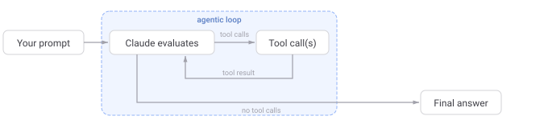

# S: Reference Repo

QR Code with reference meetup repo

# S: Long-Term Agenda

Today: Agentic Coding Harness basics
Next meetups:

1. Agent Memory
2. Subagents and Loops
3. Dark Factories and future of work
4. Harness deep-dives - retries, sandboxes, llm tokenomics

# S: Agenda

1. What is agentic harness?
2. What's under the hood?
3. Existing harnesses like pi

# S: LLMs Basics

LLMs are neural networks

LLMs are trained on a internet-scale corpus of text to predict next token

LLMs are stateless and can only produce text (not discussing multi-modal now)

Text In -> LLM -> Text Out

LLMs themselves don't manage state (messages, outputs), harness does

# S: Different LLM Providers

https://artificialanalysis.ai/ - index of LLM intelligence

There are many LLM providers. Main tradeoff is between

1. Intelligence - bigger models are usually smarter and perform better with fewer prompts
2. Cost - smaller models are cheaper but also many providers subsidise tokens to attract users
3. Speed - smaller models provide results faster
4. Availability - the more infra provider has the better the availability (e.g. Kimi/Deepseek was hard to use because a lot of demand and few servers)

Each provider has its own API (URL) for using the model

Routers provide a common interface to many providers. We'll use Openrouter as example here

Let's generate API key and put it into .env file, so we can do our first API call

# Simple LLM API call

Let's now try running a simple LLM call via Openrouter API

You'll need

../src/llm_call.py

```bash
uv run python src/llm_call.py "What is an agentic coding harness?"
```

That's really cool. However, this is all based on the knowledge in the LLM training corpus. If we ask it what's the weather like in Munich it won't be able to answer because it was trained in the past and we're asking it about current weather.

However, there are APIs available that can tell the current weather, so what if let LLM use this API

# Tool Calling

LLMs output only text but they can output structured text

```sh
uv run python src/llm_call.py "Output only json with keys 'location': 'Munich', date: '26.07.26'"
```

It produces json that we can parse and pass as the function input in our code

Now let the model decide when to call a weather tool:

```bash
uv run python src/llm_tool_call.py "What is the weather in Munich right now?"
```

The model returns a structured `get_weather` tool call. Our code sends requests
to the free Open-Meteo API and returns the current temperature

Tool result is not looking nice. What if we pass the tool result back to the model instead of just displaying it?

// uncomment the messages array

# Message history

Now we've introduced message history by appending messages and tool results to a list of messages and passing it to the model. Now we're keeping state. Note that the model itself doesn't - it just sees a new full messages list and outputs result

# Multi-Turn

The issue with our setup right now is that we can't follow up after a reply. All messages are still one-shot: text in -> text out. If I ask the model in a new call what did we discuss before it won't remember because model itself is stateless and doesn't keep memory between invocations

```sh
uv run python src/llm_tool_call.py "What did we discuss before?"
```

However, we can fix it by appending previous user messages and agent replies to the message list and passing this ever-growing list to the model. We'll use a never-ending while loop to do it, so our conversation can go on until the context window is full.

```bash
uv run python src/llm_multiturn.py
```

# Context window and Caching

Talking about context window - even with a while loop our conversation can't go on ad infinitum. Eventually LLM will "run out of memory". LLMs have "Context Windows" of different sizes which dictate how many tokens can fit in. For english it's usually considered 4 characters per token. Most models have either around 200k or 1mn tokens context window nowadays

Token costs are different for input tokens and output tokens with input tokens being much cheaper than output tokens

https://openrouter.ai/openai/gpt-5.6-luna

However, we don't pay full read price for all messages sent to the model with each invocation. Model providers cache input tokens on their side and cached tokens cost much less than new read tokens. However, for tokens to be cached the message history mush be exactly the same as before. If I change a single character in a first message the whole cache will get invalidated and we'll incur a full cost for the whole message history. We will discuss more about how to save on your tokens in a future discussion on LLM tokenomics.

# From LLM to an Agent

Now that we've seen message loop and tool calling we're ready to turn our LLM into an Agent. Agent is basically an LLM that can do meaningful work. For knowledge work meaningful usually means that we process (read) some information (text) and turn it into another form of information (another text). Therefore, to do meaningful work our agent must be ideally able to read files, write files, execute files (if they're code) and fetch data from external sources (the web).

# Almost everything can be done via terminal commands

Everything in knowledge work is about text

The terminal is a text interface to your computer. APIs are text interfaces to other computers.

With the right **permissions**, commands can read data, change data, run programs, and ask services to do work.

```bash
# Read a local file
cat src/llm_call.py

# Create and read a local file
echo "What is computation?" > question.txt
cat question.txt

# Ask a computer on the web for information
curl -sL "https://en.wikipedia.org/api/rest_v1/page/summary/Alan_Turing" \
  | jq -r '.extract'
```

The LLM command above is one more example: it sends a request to an external service and prints the response.

So, if we give our LLM ability to execute arbitrary commands it will be able to pretty much do anything with the computer.

All of those terminal commands are essentially functions similar to the weather function that we've seen before. Let's turn our LLM into an Agent now

# Agent Loop

WARNING! This agent seems simple and cute but it's incredibly powerful and dangerous - it can completely wipe out your computer, steal your credentials from .env and do all kinds of damage. It's for illustrative purposes only and shouldn't be used as agent for doing work

Our agent has one general-purpose tool: it can run Bash commands. The model
chooses a command, our harness runs it, and the command output goes back to the
model for its next decision.

```sh
uv run simple_agent.py "Create and run a fibonacci python algorithm in $PWD for n = 10"
```

For a multi-turn version that keeps the full conversation history:

```bash
uv run python src/simple_agent_interactive.py
```

The script asks for confirmation before each command. This matters because a
command tool has the same permissions as the person running the script.

This is the famous Agent Loop from the ReAct paper that is the backbone of all of the agents you've heard about - Claude Code, Codex, OpenClaw, Hermes, you name it. Basically all it's all in 120 lines of code. Everything else is infrastructure to make sure this loop is robust, safe and convenient to use.



Model takes turns - each turn is

1. Model thinks
2. Model calls tools
3. Tools return results to model

Agent Loop is turns running in a loop until model decided to not call any more tools (e.g. first it read a file - tool call, then it wrote to this file - tool call, then it executed the file - tool call, evaluated results of the tool call and finished the loop)

More advanced models also provide reasoning capability which is basically producing output tokens for model internal monologue that help it solve the problem. They are not intended to be seen by the user and are billed as output tokens

Interactive agent we've built is essentially a simplest version of Agentic Coding Harness. Congratulations, you now know what's under the hood of Claude Code, Codex, OpenClaw and all other agents out there.

# Sandboxing

Our agent can pretty much nuke our whole system because it has the same permissions as the user which invoked it which is most likely root user in our case. We've added a simple guardrail for user to approve each command invocation. However, this is not the best approach since it quickly leads to approval fatigue when user doesn't read the tool calls anymore and blindly accepts everything.

Production-grade agentic harnesses solve this by adding sandbox envrionments around the agent. For example, limiting agent to only reading and writing within the current repository or disabling network access for the agent, so a malicious prompt injection can't cause agent to exfiltrate credentials or leak personal info.

# Pi

Besides sandbox hardening production grade harnesses also provide

- Nice TUI interface
- Model retries
- Security guardrails
- Persistent memory, skills, subagents, loops (future meetups)

One such production-grade harness is pi built by our neighbour Mario Zechner from Austria. I'd like to share pi with you because of several reasons

- Open Source - you know what's going on inside and can tweak it
- Model-agnostic - no vendor lock-in, can use local models too
- Minimalistic - only essential stuff, rest through extensions
- TypeScript - easier for ppl than rust
- Battle-tested - powers OpenClaw
- Well-written - authors deeply care about code quality

However, pi is also quite powerful and dangerous because of its minimalism. It doesn't come with a sandbox out of the box and you need to install it yourself via https://github.com/earendil-works/pi/tree/main/packages/coding-agent/examples/extensions/sandbox/

The cool thing about coding agents is that you can ask them to install and setup the extension instead of doing it manually

# Conclusion

I hope now you better understand how an agentic harness works under the hood.

We've covered:

- LLMs as stateless text-in, text-out systems
- Model providers, routers, and a simple OpenRouter API call
- Structured output and tool calling with a weather API
- Message history and multi-turn conversations
- Tokens, context windows, costs, and prompt caching
- Terminal commands and APIs as tools for doing work
- The agent loop: model, tool call, tool result, repeat
- Command permissions, confirmation prompts, and sandboxing
- Why production harnesses such as pi add interfaces, retries, memory, and guardrails

# Q&A

Are there any questions?

# Handoff

Now it's time to put the agents to work on our agent competition platform!

# References

# Appendix

Claude Images

# TODO:

1. Create slides
2. Add references to docs and blogs
3. Dry run e2e
4. Add claude images from imgs/ to the appendis
