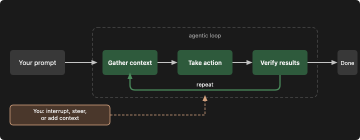
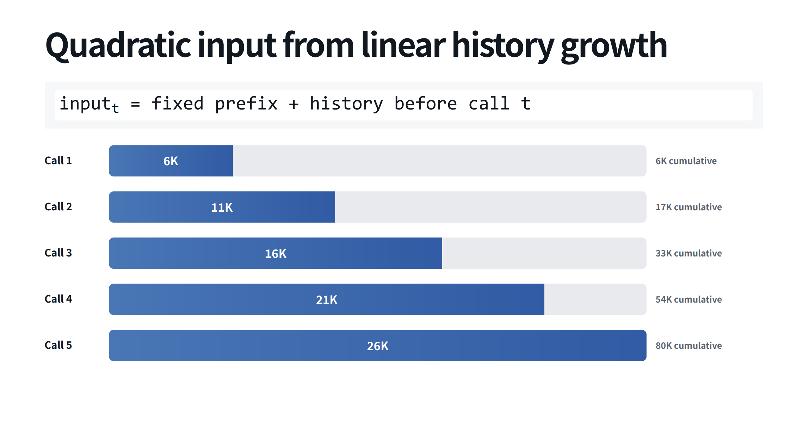
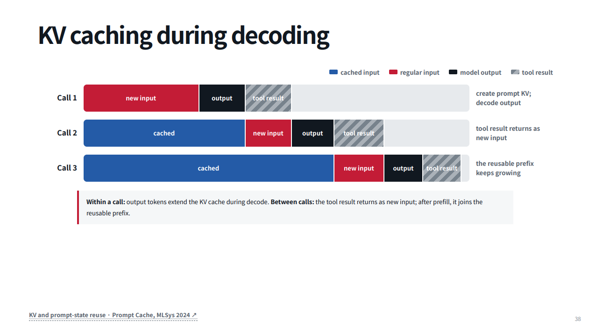
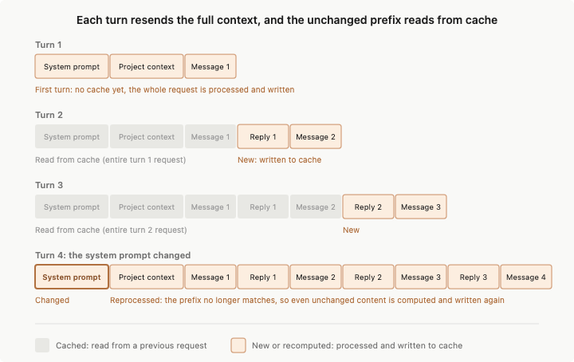
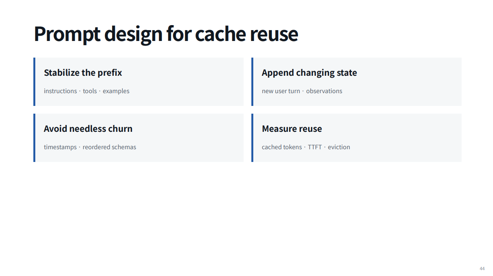

# Context Management for Agents

Notes for Context Management workshop

[Slide deck](context-management-deck.pdf)

# 1. Intro

"A lot of apparent “model quality” is really context quality" - Sebastian Raschka

## Agenda for today

1. Context Management Overview
   1. Context Anatomy: what is the context window and what goes in it
   2. Context Rot: why longer context hurts
   3. Caching: make-it-or-break-it for prod agents
   4. Context engineering techniques
   5. So what? Lessons for everyday interactions with agents
   6. Demo: custom educational harness based on codex
2. Workshop: manage context for trader agents

## References

1. https://code.claude.com/docs/en/how-claude-code-works - best source!
2. https://www.youtube.com/playlist?list=PLSN0qpDfUvTM - amazing graduate-level course from CMU on AI Agents (Autumn 2026 - fresh!)
3. https://learn.chatgpt.com/docs - Codex docs

# 2. Refresher

Last time we discussed

- What is an Agent? - An agent is an LLM autonomously using tools in a loop [1]
- agent loop
- sessions - jsonl files on disk with all of the messages in this session
- tool calling - model replies with text that we parse into function parameters and call function locally
- guardrails - sandbox (what agent can see and do), permissions - what you allow agent to do
- built our small harness (agentic loop with bash tool)

Best reference here is How Claude Code works page [2]

## References

1. https://simonwillison.net/2025/Sep/18/agents/
2. https://code.claude.com/docs/en/how-claude-code-works

# 3. Context Anatomy

What goes into context window? Everything the model sees in one request, plus the reply it writes. Codex as the example (pinned commit `1c7c43cd85`), in request order:

1. **Base instructions** - the harness's system prompt, ~18k chars for `gpt-6-luna`. In Codex it's the first `developer` message; there is no `system` message
2. **Tool definitions** - built-in tools + MCP tools (one namespace per MCP server). Sent in the `tools` field, the provider renders them into the prompt
3. **Developer context** - rules from the harness
   1. Permissions: sandbox and approval rules
   2. Developer instructions from config, collaboration mode (Default / Plan)
   3. Skills: only name + description + path, the body loads on demand.
      1. Skills add reusable knowledge and invocable workflows
   4. Memories, plugins, apps (when enabled)
      1. e.g. for Claude first 200 lines or 25KB of MEMORY.md, whichever comes first, load at the start of each session.
4. **User context** - facts from the user's world
   1. AGENTS.md: global + every folder from git root to cwd, 32 KiB cap
   2. `<environment_context>`: cwd, shell, date, timezone, sandbox
5. **The conversation** - past output that grows with every iteration
   1. User messages
   2. Assistant messages
   3. Reasoning items
   4. Tool calls and tool outputs
6. **Injected mid-session** - appended, never edited
   1. Context updates: new permissions / environment when settings change
   2. Model switch notice, turn aborted marker, current time reminder, token budget
   3. Hook output, subagent notifications
   4. Compaction summary
   5. File-specific rules like \*\*.py file rules (e.g. use uv, not pip)
7. **Hidden on the provider side** - not in the JSON at all
   1. Chat template: roles become special tokens
   2. Tool schemas rendered as text (Harmony: TypeScript-like signatures in the developer message) [2]
   3. A provider system message (Harmony: knowledge cutoff, date, reasoning effort, valid channels)
8. **The output** - the reply and its reasoning tokens share the same window

Rule of thumb for roles: rules from the harness are `developer`, things from the user's world are `user`. Priority: system > developer > user > assistant > tool. So a line in AGENTS.md can't override the sandbox rules, and instructions inside tool output are information, not commands.

What you see vs what the model sees: "Read auth.ts" in the UI, 2,400 tokens of file content in the window.

Context grows with each new message that you send

What's the typical breakdown:

- OpenHands, 1,500 sessions, mean 78K tokens: system + tools 23%, user 9%, reasoning 9%, tool calls 20%, tool results 37% ([image](materials/images/context-composition-cropped.png))
- My Claude Code sessions: tool calls + outputs 67% of unique tokens ([image](materials/images/context-composition-my.png))

Tokenomics [6]: ChatDev multi-agent system, GPT-5, 30 software tasks. Narrow setup, so treat it as an example, not a rule.

By token type (sums to 100%):

- 53.9% input: prompts, tools, history
- 21.6% reasoning
- 24.4% output: code, text, tool calls

By stage: avg share of task tokens, only in the tasks where the stage ran. These do not sum to 100%:

- 59.4% code review (all 30 tasks)
- 26.8% code completion (6 of 30 tasks)
- 20.1% documentation
- 10.3% testing (12 of 30 tasks)
- 8.6% coding
- 2.4% design

Punchline: agents pay to read, not to write. Code review costs ~7x the tokens of coding.

## References

1. [Explore the context window](https://code.claude.com/docs/en/context-window) - great source on context window
2. [OpenAI Harmony response format](https://developers.openai.com/cookbook/articles/openai-harmony) - the hidden layer: how roles and tools become tokens (gpt-oss)
3. [Codex source: `core/src/context/`](https://github.com/openai/codex/tree/1c7c43cd856a1ef451cb7ff9dc1b701ac7942c9d/codex-rs/core/src/context) - every fragment Codex can inject, each with its role. Real layout: [model_visible_layout snapshot](https://github.com/openai/codex/blob/1c7c43cd856a1ef451cb7ff9dc1b701ac7942c9d/codex-rs/core/tests/suite/snapshots/all__suite__model_visible_layout__model_visible_layout_cwd_change_refreshes_agents.snap)
4. [OpenAI Model Spec, Chain of Command](https://model-spec.openai.com/2026-08-18.html) - role priority; tool output has no authority
5. [Unrolling the Codex agent loop](https://openai.com/index/unrolling-the-codex-agent-loop/) - OpenAI, 2026-01. One real request, item by item. A bit outdated (still uses `instructions`) - notice how fast things change
6. [Tokenomics: Quantifying Where Tokens Are Used in Agentic Software Engineering](https://arxiv.org/abs/2601.14470) - Salim et al., 2026-01. Token split by type and SDLC stage in ChatDev

# 4. Context Rot

Context rot: as the context grows, the model gets worse at using it [1, 2]. A model that _accepts_ 1M tokens doesn't _use_ 1M tokens well. And every request gets slower and more expensive.

## Why we want long context anyway

Migrations and large refactors, deep research, long autonomous runs, one big document, many-shot examples in the prompt, long media, hard and vague tasks where you can't pick the context upfront.

## The price

Each call resends the fixed prefix plus the whole history: each call grows linearly, the total grows quadratically (6K + 11K + 16K + 21K + 26K = 80K after 5 calls). Caching reuses the prefix, but the model still attends to all of it.

| Cost              | What you notice                       | Key evidence                                                                                                                                        |
| ----------------- | ------------------------------------- | --------------------------------------------------------------------------------------------------------------------------------------------------- |
| 1. Worse quality  | Weaker reasoning, repeated mistakes   | Length alone: −13.9–85%, even with extra tokens as whitespace [3]. Codex: 8/10 short vs 3/10 long history                                           |
| 2. Worse accuracy | Forgets instructions, mixes up facts  | Lost in the middle [5]. One distractor hurts all 18 models [1]. No shared words: 99.3% → 69.7% at 32K [6]. 500 instructions: best models follow 68% |
| 3. Slower         | Long wait for the first word          | Prefill is O(n²): 2x context = 2–4x prefill. Caching: up to 67% faster TTFT at 150K+                                                                |
| 4. More expensive | Bills grow faster than session length | Whole history resent each step: total grows with N². Caching cuts ~8x, but still quadratic                                                          |

Bad context makes 1 and 2 worse [4]: **poisoning** (a hallucination keeps being referenced), **distraction** (repeats past actions), **confusion** (too many tools), **clash** (parts contradict each other).

## Why 1 and 2 happen

- **Attention is a fixed budget** - weights add up to 100%, so more tokens = less for each. A highlighter with a fixed amount of ink [2]
- **Position bias** - models favour the start and the end, whatever is there
- **Little practice** - long documents are rare, so models train mostly on short text. They can _run_ at 1M tokens, not _use_ them well [7]

## Cost in numbers

Illustrative: 20K fixed prompt, +2K per step, 100 steps, $3 per 1M input. No cache: 12.1M tokens, $36. With cache [8]: ~1.46M equivalent, ~$4.4.

- Step 100 costs 10x step 1. The second half costs 2.4x the first half
- 5 fresh sessions of 20 steps: 3x fewer tokens than one of 100
- One cache miss at 220K (e.g. a model switch) = ~11 cached steps
- 2x the steps = ~3.5x the bill, cached or not. Only shorter contexts change the shape

One line for the slide: _a long session doesn't just cost more, it costs more per step, and caching makes it cheaper without making it scale better._

## So what?

- Start a new session for a new task. Compact or hand off with a short summary
- Put what matters at the start or the end. Restate the goal near the end (todo lists do this)
- Correct the agent early or start over. Don't argue with a poisoned context
- Don't break the cache mid-session: same model, same tools

## References

1. [Context Rot](https://www.trychroma.com/research/context-rot) - Chroma, 2025-07. 18 models, length is the only variable
2. [Effective context engineering for AI agents](https://www.anthropic.com/engineering/effective-context-engineering-for-ai-agents) - Anthropic, 2025-09. The "attention budget"
3. [Context Length Alone Hurts LLM Performance Despite Perfect Retrieval](https://arxiv.org/abs/2510.05381) - Du et al., EMNLP Findings 2025
4. [How Long Contexts Fail](https://www.dbreunig.com/2025/06/22/how-contexts-fail-and-how-to-fix-them.html) - Drew Breunig, 2025-06. Poisoning, distraction, confusion, clash
5. [Lost in the Middle](https://arxiv.org/abs/2307.03172) - Liu et al., TACL 2023
6. [NoLiMa](https://arxiv.org/abs/2502.05167) - ICML 2025. See also the [needle in haystack image](materials/images/needle-in-haystack.png)
7. [CMU 11-768, Lecture 3: Long Context Modeling for Agents](https://youtu.be/AiwCCvFW1uE?t=2205) - Graham Neubig, 2026-09, [slides](https://cmu-agents.com/slides/lecture-03-long-context.pdf)
8. [Prompt caching](https://platform.claude.com/docs/en/build-with-claude/prompt-caching) - Claude API docs. Read and write prices

# 5. Caching

"If I had to choose just one metric, I'd argue that the KV-cache hit rate is the single most important metric for a production-stage AI agent" - Yichao Ji, Manus [5]

Caching means saving the result of an expensive operation and reusing it in the next request instead of recomputing it

The API caches by matching the start of each request, called the prefix, against content it recently processed.

The prompt cache stores key-value (KV) tensors, not the tokens themselves.

To get the most out of prefix matching, Claude Code orders each request so content that rarely changes between turns comes first (System prompt -> Project context -> Conversation)

## Cache benefits

1. **Cheaper.** A cache read costs 0.1x the input price (0.05x on Claude Opus and Sonnet 5.5, 0.025x on Fable 5.1). A write costs 1.25x (5 min TTL) or 2x (1 h TTL), so a 5-min cache pays off after one read [1]. OpenAI GPT-5.6+: write 1.25x, read 0.1x [2]. Anthropic's research agent: cost cut 2.7–5.5x [10]
2. **Faster.** Time to first token: −7% at 1K tokens, −67% at 150K+ in OpenAI's test of 2,300 runs. The longer the prompt, the bigger the win [9]. Vendor claims: "up to 80%" (OpenAI) [9], "up to 85% for long prompts" (Anthropic). In agent sessions: −13–31% TTFT [3]
3. **More throughput.** On most Claude models, cache reads don't count toward the input-tokens-per-minute limit. 2M ITPM limit + 80% hit rate = 10M input tokens per minute [6]
4. **No quality cost.** Same model, same output. Only the compute is reused [9, 10]

What good looks like: agent loops read a median 84% of input from cache, the top 10% read 94%+. Below 80%, look for something that breaks the cache [10]

## Ways to cache

1. **Implicit (automatic).** The provider caches common prefixes for you. You change nothing in the request. It is "best effort": no hit is guaranteed [2, 7, 8]
2. **Explicit breakpoints** (Bedrock calls them "cache checkpoints"). You put a marker on a block: "cache everything up to here". Each marker writes one cache entry. The next request reads the longest entry that still matches. Usually up to 4 markers per request [1, 2, 7]
3. **Cache objects.** You upload the content once and get a cache ID. Then you refer to that ID in later requests. You pay for storage per hour until the TTL ends (default 1 h) [8]. Good for one big document that many requests use, not for a growing chat

## Cache breakers

1. Changing anything in the prefix invalidates the cache from the change on (e.g. changing previous response, changing system prompt, adding new tools) - that's why knowing what is in context window and in what order (!) is important.
2. Model change - each model has its own cache. Switching models recomputes entire request.
3. Effort level change - each effort level has its own cache (fixed for GPT-6 and Claude 5.5 but only on native API)
4. Connecting or removing an MCP server
5. Enabling or disabling a plugin
6. Compacting the conversation
7. Accumulating many images
8. Upgrading the harness

## Cache TTL

Codex: 30m (new models), 5-10m or up to 24h (earlier models)
Claude: 5m (write 1.25x input price) or 1h (write 2x input price) [1]

Cache TTL is provider-specific, so check with your provider (e.g. AWS, Bedrock)

## Best practices

- Static content first (e.g. system prompt for code reviewer agent), dynamic last (e.g. code to review)
- Pick your model and effort level at the top of a session, then save /compact for natural breaks between tasks. The fewer changes you make mid-task, the higher your cache hit rate.
- Rewind when last few messages went into wrong direction (prior cache would work)
- Set longer cache TTL e.g. 1 hour vs 5 min (else each 5 min you pay full cache again)
- Monitor cache hit rate
- Cache pre-warming for latency-critical applications
- The TTL counts from the _start_ of the request. A 4-minute streamed answer leaves ~1 minute for the next call

## References

1. [Prompt caching](https://platform.claude.com/docs/en/build-with-claude/prompt-caching) - Claude API docs. TTL, prices, what invalidates what, concurrency
2. [Prompt caching](https://developers.openai.com/api/docs/guides/prompt-caching) - OpenAI API docs. Retention, `prompt_cache_key`, routing
3. [Don't Break the Cache](https://arxiv.org/abs/2601.06007) - Lumer et al., 2026-01. 500+ agent sessions on OpenAI, Anthropic, Google: −41–80% cost, −13–31% TTFT
4. [Lessons from building Claude Code: Prompt caching is everything](https://claude.dev/blog/lessons-from-building-claude-code-prompt-caching-is-everything/) - Thariq Shihipar, 2026-04. Best single read: ordering, model switch trap, plan mode, cache-safe compaction
5. [Context Engineering for AI Agents: Lessons from Building Manus](https://manus.im/blog/Context-Engineering-for-AI-Agents-Lessons-from-Building-Manus) - Yichao Ji, 2025-07. KV-cache hit rate as the main metric, append-only context, logit masking
6. [Rate limits: cache-aware ITPM](https://platform.claude.com/docs/en/api/rate-limits) - Claude API docs. Cache reads don't count toward ITPM on most models
7. [Prompt caching](https://docs.aws.amazon.com/bedrock/latest/userguide/prompt-caching.html) - Amazon Bedrock docs. Cache checkpoints
8. [Context caching](https://ai.google.dev/gemini-api/docs/caching) - Gemini API docs. Implicit caching and cache objects
9. [Prompt Caching 201](https://developers.openai.com/cookbook/examples/prompt_caching_201) - OpenAI Cookbook. TTFT −7% at 1K to −67% at 150K+, `prompt_cache_key` routing
10. [Optimizing for cost and intelligence](https://platform.claude.com/docs/en/about-claude/models/optimizing-for-cost-and-intelligence) - Claude docs. Median 84% cache reads in agent loops, measured savings

# 6. Context Engineering

## What is Context Engineering

Caching makes long context cheaper. Context engineering is a set of practices to distill the context to the most essential for accomplishing task

"Good context engineering means finding the smallest possible set of high-signal tokens that maximize the likelihood of some desired outcome" - Anthropic

"Delicate art and science of filling the context window with just the right information for the next step" - Andrej Karpathy

"CE is the art of providing all the context for the task to be plausibly solvable by the LLM." - Tobi Lutke (Shopify CEO)

Prompt engineering - how to tailor input for a one-off model response

Context engineering - how to set up a system around LLM to provide it with right information to complete the task over multiple turns

Anthropic rules of effective context engineering

- System prompts should be extremely clear and use simple, direct language that presents ideas at the right altitude for the agent. [1]
- Tools should be returning information that is token efficient and by encouraging efficient agent behaviors. See [2]
- Our overall guidance across the different components of context (system prompts, tools, examples, message history, etc) is to be thoughtful and keep your context informative, yet tight

## Context Engineering techniques

1. Write: notes/memory, file-system offloading, recitation (todo)
2. Select: just-in-time retrieval, progressive disclosure (skills, tool search, CLI --help)
3. Compress: tool result clearing, compaction, token-efficient tools / output trimming
4. Isolate: subagents, code execution sandbox
5. Constraint for all of them: keep the prefix stable for the cache

### Write context

Save context outside the window, so it survives. Two levels, by what is written: task state or durable knowledge (scratchpads vs memories in [9]).

**A. Task memory: lives until the task is done.** Problem: the window fills up, the goal gets lost in the middle, and after compaction or in a new session the agent starts with an empty head

1. **Offload raw data to files** - big tool outputs go to disk, only a path or URL stays in context. Restorable: the agent can read it again [8]
2. **Plan and recitation** - a todo list or plan file, updated each step. Puts the goal at the end of the context, where attention is best [8]. E.g. Claude Code todos, Manus `todo.md`
3. **Scratchpad notes** - findings and decisions as the agent works, e.g. NOTES.md, session scratchpad [1, 5]. Anthropic's multi-agent researcher saves its plan first, as context over 200K gets cut off [9]
4. **Handoff: progress file + git + task list** - makes 1–3 survive compaction or a new session. At the end of a session: commit and update `progress.txt`. At the start: read it, `git log` and `feature_list.json` [10]. JSON, as the model overwrites it less often than Markdown. SPEC.md for a fresh session is the same pattern

**B. Long-term memory: lives across tasks.** Problem: each session forgets what the last one learned

5. **Human-written** - AGENTS.md / CLAUDE.md. Always loaded, so keep it short
6. **Agent-written during work** - the agent decides to save a fact. E.g. Claude Code auto memory, Anthropic memory tool, ChatGPT memory [6]
7. **Consolidated offline ("dreaming")** - a background job reads old sessions and merges them into memory. E.g. Codex memories, sleep-time compute, Reflexion, Generative Agents [7, 9]

**Kinds of memory** (CoALA [11], via [9])

| Type       | What             | Example                               |
| ---------- | ---------------- | ------------------------------------- |
| Semantic   | Facts            | "user prefers uv", project structure  |
| Episodic   | Past experiences | "last time this test failed because…" |
| Procedural | How to do things | AGENTS.md rules, skills               |

**What Write costs**

- Write is only half: a note helps only if it is read back at the right time. Always loaded or on demand is a Select question
- Wrong or stale memory = poisoning that persists across sessions. Old notes can contradict new facts (clash)
- Memory can leak into unrelated tasks
- Who writes: the agent during work spends tokens and attention mid-task; an offline job costs nothing mid-task, but memory arrives late (Codex waits 6h+ of idle)

**(Aside) Codex memories in simple terms**

Think of a diary that is written at night, not during the day.

1. During the day you work as usual. Codex saves each chat to a rollout log file. Nothing about memory happens yet.
2. Later, a "note-taker" reads your old chats. When a chat has been idle for 6 hours or more, a background job makes one LLM call per chat: "Is there anything here that will help a future agent? If yes, write a short summary and notes." Most chats give nothing.
3. Then an "editor" merges all the notes. A sandboxed sub-agent, whose only job is the memory folder, rewrites two files:
   - MEMORY.md: the big handbook. It has full detail and is split by project.
   - memory_summary.md: a short cover page. It has who the user is, their preferences, general tips, and a table of contents of what is in MEMORY.md.
4. In each new chat, Codex adds only the cover page to the prompt. The cover page comes with instructions: "if this task looks related, grep MEMORY.md for these keywords".

### Select Context

Pull into the window only what the next step needs. Structured by who selects and when: pre-inference retrieval vs just-in-time [1]. How we search (keyword or semantic) is a separate axis, so RAG is not the opposite of JIT.

**A. Upfront: the harness selects before the call**

1. **Always loaded** - system prompt, AGENTS.md, skill metadata, `@file` mentions
2. **Pre-inference retrieval (classic RAG)** - embed the query, put top-k chunks in the prompt. The model can't ask for more
3. **Tool loadout by retrieval** - pick tool definitions per task with RAG. Tool choice gets confused above ~30 tools [15]

**B. On demand: the agent selects at runtime (just-in-time)**

4. **Agentic search** - grep / glob / read ranges / `head` / `tail`, refining the query from results. Claude Code tried local vector DBs and recursive indexing: plain glob and grep beat everything (stale indexes, permissions) [14]
5. **Semantic search as a tool (agentic RAG)** - same embeddings, but the agent decides when. Cursor: +12.5% accuracy on average (6.5–23.5%) when added to grep, most in 1,000+ file codebases. Both together work best [13]
6. **Progressive disclosure** - a small index always loaded, details on demand [1]. Same pattern in three places:
   - Skills: name + description → `SKILL.md` body → bundled files [12]
   - Tools: tool search with `defer_loading` (−85% tokens) [16], MCP tools as code files [17], CLI `--help`
   - Memory: Codex `memory_summary.md` always loaded → grep `MEMORY.md`

**C. Hybrid** - most real agents. Claude Code loads CLAUDE.md upfront and greps for the rest. Fits less dynamic content better, e.g. legal or finance [1]

**Two axes together**

|                       | Keyword / structure (grep, paths)  | Semantic (embeddings)       |
| --------------------- | ---------------------------------- | --------------------------- |
| **Upfront (harness)** | AGENTS.md, `@file`                 | Classic RAG                 |
| **On demand (agent)** | Claude Code / Codex agentic search | Cursor semantic search tool |

**What Select costs**

- On demand is slower: more turns, and each search result adds tokens [1]
- The agent doesn't know what it doesn't know: a weak skill or tool description means it never gets loaded
- Upfront can add noise: wrong chunks distract and confuse, stale indexes give old code
- Changing what is loaded breaks the cache. Manus: "mask, don't remove" tools mid-task [8]. Tool search avoids it, as deferred tools are not in the prefix [16]

### Compress context

Fewer tokens for the same information. Structured by where we cut: before tokens enter the context, or after. After, we either discard or condense [20].

**A. At the source: make it small before it enters**

1. **Token-efficient tools** - return only what the agent needs: pagination, filters, truncation, concise response format. Claude Code caps tool responses at 25K tokens by default [2]
2. **Output filters** - RTK intercepts shell commands and compresses their output: test failures only, short `git status`, `git log` with hash and subject. 60–90% less bash output, but not 60–90% off the bill [4]
3. **Terse model output** - Caveman: ask the model for short, plain replies, e.g. "80% of the way to ASD-STE100", a simplified technical English [3]. The output is input on the next turn. DIY trick, weak evidence

**B. In the history: discard (deterministic, no LLM)**

4. **Tool result clearing / observation masking** - replace old tool outputs with a placeholder, keep the call. Same for old thinking blocks [19]
   - JetBrains: half the cost, same solve rate as LLM summarisation [20]
   - Anthropic: +29% on agentic search, −84% tokens in a 100-turn eval [18]
   - Restorable if the output was offloaded to a file (Write #1)

**C. In the history: compaction (LLM, lossy)**

5. **Compaction** - summarise the history, start a new window with the summary [1]
   - Claude Code keeps architecture decisions, open bugs and the 5 most recently read files [1]. Steer it with `/compact <focus>` or partial compaction from `/rewind`
   - Codex sends the history plus a `compaction_trigger` item to the Responses API. The server returns an encrypted, opaque compaction item. The new window is that item plus some items kept from the old window [21, 22]. You can't read what it kept
6. **Recursive / hierarchical summarisation** - summarise chunks, then summarise the summaries. See [recursive summarisation](https://arxiv.org/abs/2308.15022) and [hierarchical summarisation](https://alignment.anthropic.com/2025/summarization-for-monitoring)

**D. Hybrid**

7. **Mask first, summarise only when masking is not enough** - −7% cost vs masking alone, −11% vs summarisation alone, slightly higher solve rate [20]

**What not to remove**

- Errors: failed actions and stack traces stay, so the agent doesn't repeat them [8]
- The plan / todo list, the last N tool results, the user's instructions

**What Compress costs**

- Summaries lose details, and you can't see which ones. You get them back only if the raw data is on disk
- Cache, the summary call: it can hit the cache. Claude Code uses cache-safe forking: same system prompt, tools and history, the compaction prompt appended as the last user message. A separate "summarize this" call with no tools gets no cache hits [23]
- Cache, after compaction: the new history is a new prefix and is written again. Only the system prompt and tools stay cached. Clearing also breaks the cache from the change on, so clear in big chunks (`clear_at_least`) [19]
- Summarisation costs tokens and time, and needs a buffer for the compaction prompt and the summary [23]. Masking is free

### Isolate context

Keep tokens in another place, so they never reach the main context. Structured by where they are kept: in another context window or outside the LLM [9].

**A. In another context window: subagents**

"The essence of search is compression" [24]: a subagent explores with tens of thousands of tokens and returns 1–2K [1].

Patterns, by role:

1. **Explorer / researcher (read-only)** - reads a lot, returns a summary. E.g. Claude Code Explore (on Haiku), Anthropic Research: lead Opus 4 + Sonnet 4 subagents beat Opus 4 alone by 90.2%. Token use alone explains 80% of the variance on BrowseComp [24]
2. **Clean-context reviewer** - never saw the build, so no bias and a short context. Devin Review works best when coder and reviewer share no context [26]. Fresh-context evaluator in [10]
3. **Parallel workers** - independent subtasks at the same time, up to 90% faster research [24]. Parallel writers make conflicting implicit decisions, so writes stay single-threaded [25, 26]
4. **Another model** - switching models mid-session breaks the cache, so use a subagent with a handoff message [23]

Design knobs:

- **Context in** - fresh brief or fork of the parent. A brief needs objective, output format, tools and boundaries, else subagents duplicate work or misread the task [24]. A fork shares the parent's prefix, so it hits the cache [23]
- **Context out** - summary, or files + a reference back, to avoid the "game of telephone" [24]
- **Permissions** - read-only is the safe default [26]

**B. Outside the LLM: code execution sandbox**

5. **Code execution / programmatic tool calling** - the agent writes a script, intermediate results stay in the sandbox, only the final output enters the context
   - MCP tools as code files: 150K → 2K tokens [17]
   - Programmatic tool calling: −37% tokens [16]. No gain for strictly sequential calls (τ²-bench: +8% cost) [27]

**What Isolate costs**

- Tokens: agents use ~4× the tokens of chat, multi-agent ~15× [24]. Worth it only for valuable, parallel tasks
- Loss at the handoff: the subagent doesn't see the parent's context, the parent sees only the summary
- Coding fits less: "most coding tasks involve fewer truly parallelizable tasks than research" [24]
- Sandbox overhead (container start-up, script writing) pays off only with fan-out or big results [27]

### Constraint for all of them: the cache

Each technique changes what is in the context, and any change in the prefix breaks the cache from that point on (section 5). So ask of each technique: does it keep the prefix stable?

| Technique                 | Cache effect                               | Cache-friendly way                                           |
| ------------------------- | ------------------------------------------ | ------------------------------------------------------------ |
| Write: notes, todo        | None, appended as new messages             | Updates go in messages, not in the system prompt [23]        |
| Select: add/remove tools  | Breaks all of it, tools are near the start | Mask, don't remove [8]. Tool search with deferred stubs [23] |
| Select: on-demand loading | None, results are appended                 | -                                                            |
| Compress: clearing        | Breaks from the first cleared result       | Clear in big chunks (`clear_at_least`) [19]                  |
| Compress: compaction      | New history = new prefix                   | Cache-safe fork for the summary call [23]                    |
| Isolate: subagent         | Fresh brief = own new cache                | Fork shares the parent's prefix [23]                         |
| Isolate: another model    | Each model has its own cache               | Subagent with a handoff, not a mid-session switch [23]       |

Rule of thumb: append, don't edit. Pay for a cache break only when it removes many tokens.

## References

1. https://www.anthropic.com/engineering/effective-context-engineering-for-ai-agents
2. https://www.anthropic.com/engineering/writing-tools-for-agents
3. https://blog.jetbrains.com/ai/2026/07/speak-to-ai-agents-like-cavemen-tosave-tokens/
4. https://github.com/rtk-ai/rtk
5. https://code.claude.com/docs/en/claude-directory#session-scratchpad-directory
6. https://code.claude.com/docs/en/memory
7. https://arxiv.org/abs/2504.13171 - Sleep Time Compute (Dreaming)
8. [Context Engineering for AI Agents: Lessons from Building Manus](https://manus.im/blog/Context-Engineering-for-AI-Agents-Lessons-from-Building-Manus) - Manus, 2025-07. File system as context, recitation
9. [Context Engineering for Agents](https://blog.langchain.com/context-engineering-for-agents/) - LangChain, 2025-07. Write / select / compress / isolate
10. [Effective harnesses for long-running agents](https://www.anthropic.com/engineering/effective-harnesses-for-long-running-agents) - Anthropic, 2025-11. Progress file, feature list, git handoff
11. [Cognitive Architectures for Language Agents (CoALA)](https://arxiv.org/abs/2309.02427) - Sumers et al., 2023. Memory types
12. [Equipping agents for the real world with Agent Skills](https://www.anthropic.com/engineering/equipping-agents-for-the-real-world-with-agent-skills) - Anthropic, 2025-10. Three levels of progressive disclosure
13. [Improving agent with semantic search](https://cursor.com/blog/semsearch) - Cursor, 2025-11. Semantic search + grep
14. [Building Claude Code with Boris Cherny](https://newsletter.pragmaticengineer.com/p/building-claude-code-with-boris-cherny) - Pragmatic Engineer, 2026-03. Agentic search beat RAG
15. [How to Fix Your Context](https://www.dbreunig.com/2025/06/26/how-to-fix-your-context.html) - Drew Breunig, 2025-06. Tool loadout, RAG-MCP
16. [Introducing advanced tool use](https://www.anthropic.com/engineering/advanced-tool-use) - Anthropic, 2025-11. Tool search, programmatic tool calling
17. [Code execution with MCP](https://www.anthropic.com/engineering/code-execution-with-mcp) - Anthropic, 2025-11. MCP tools as code files, 150K → 2K tokens
18. [Managing context on the Claude Developer Platform](https://claude.com/resources/articles/context-management) - Anthropic, 2025-09. Context editing and memory tool results
19. [Context editing](https://platform.claude.com/docs/en/build-with-claude/context-editing) - Claude API docs. Tool result and thinking clearing, `clear_at_least`
20. [The Complexity Trap](https://arxiv.org/abs/2508.21433) - Lindenbauer et al., JetBrains, NeurIPS 2025. Observation masking vs LLM summary
21. [Compaction](https://developers.openai.com/api/docs/guides/compaction) - OpenAI API docs. Encrypted compaction item
22. [Codex `compact_remote_v2.rs`](https://github.com/openai/codex/blob/main/codex-rs/core/src/compact_remote_v2.rs) - how Codex calls remote compaction
23. [Lessons from building Claude Code: Prompt caching is everything](https://claude.dev/blog/lessons-from-building-claude-code-prompt-caching-is-everything/) - Thariq Shihipar, 2026-04. Cache-safe forking for compaction
24. [How we built our multi-agent research system](https://www.anthropic.com/engineering/multi-agent-research-system) - Anthropic, 2025-06. Orchestrator-worker, 15× tokens, artifacts
25. [Don't Build Multi-Agents](https://cognition.com/blog/dont-build-multi-agents) - Cognition, 2025-06. Share context, actions carry implicit decisions
26. [Multi-Agents: What's Actually Working](https://cognition.com/blog/multi-agents-working) - Cognition, 2026-04. Clean-context reviewer, single-threaded writes
27. [Programmatic tool calling](https://platform.claude.com/docs/en/agents-and-tools/tool-use/programmatic-tool-calling) - Claude API docs. When it pays off and when it doesn't

# Takeaways

If they keep only one: _the context window is the agent's working memory. Everything in it costs money, time and attention, so put in only what the next step needs._

1. **The model sees far more than you typed, and all of it again on every call.** System prompt, tools, AGENTS.md, skills, history, tool outputs; the API is stateless. → Run `/context` once and look
2. **More context isn't free.** The model gets worse at using it, and each step costs more: cost grows with the square of session length. → 1M is a limit, not a target. One task per session, start over instead of arguing with a poisoned context
3. **Caching is the rule everything else must respect.** ~8–10x cheaper, but only while the prefix stays the same. One model switch at 200K ≈ 11 normal steps. → Pick model and tools at the start, append don't edit, compact at natural breaks
4. **Context engineering = the smallest set of high-signal tokens**, not more information. → For each token: does the next step need it?
5. **Four moves: Write, Select, Compress, Isolate.** Write it down so it survives, select only what the next step needs, compress what is there, isolate heavy work in another window. → For any new feature, ask "which of the four is it?"
6. **Simple usually beats clever.** Masking old tool outputs ≈ LLM summarisation at half the cost; grep beat vector RAG in Claude Code; a todo file keeps the goal in attention. "Do the simplest thing that works" will likely remain our best advice for teams building agents on top of Claude [Anthropic](https://www.anthropic.com/engineering/effective-context-engineering-for-ai-agents). → Start simple, add complexity only when you can measure the gain
7. **Every technique throws something away, so know what.** Compaction loses details you can't see, subagents lose the parent's context, memory goes stale, tool changes break the cache. → Keep what matters on disk (spec, progress, notes), so it can be read back

## Claude Code best practices for context [1]

Core rule: "the context window is the most important resource to manage". Performance degrades as it fills, and Claude starts to "forget" earlier instructions.

1. **Watch it.** Run `/context` to see what's loaded. Put context usage in a custom status line
2. **One task per session.** `/clear` between unrelated tasks. Avoid the "kitchen sink session"
3. **Start over, don't argue.** After two failed corrections the context is full of failed approaches. `/clear` and write a better prompt with what you learned
4. **Correct early.** `Esc` stops Claude and keeps context. `Esc Esc` / `/rewind` restores conversation and/or code to a checkpoint
5. **Compact on your terms.**
   1. `/compact <focus>`, e.g. `/compact Focus on the API changes`
   2. Partial compaction from `/rewind`: "Summarize from here" or "Summarize up to here"
   3. Tell CLAUDE.md what must survive compaction, e.g. the list of modified files and test commands
6. **Keep side questions out.** `/btw` answers never enter the conversation history
7. **Isolate exploration in subagents.** They read many files in their own window and return only a summary. Scope investigations, or Claude reads hundreds of files ("infinite exploration")
8. **Keep CLAUDE.md short.** It loads every session. For each line ask "would removing this cause mistakes?". Too long and rules get lost. Move rare knowledge to skills (loaded on demand) and must-happen rules to hooks
9. **Prefer CLI tools** (`gh`, `aws`, ...) - the most context-efficient way to reach external services
10. **Fresh context for fresh work.**
    1. Write a spec (SPEC.md), then implement it in a new session
    2. Review in a fresh session or subagent: it isn't biased toward code it just wrote
11. **Treat sessions as branches.** `/rename` them, `claude --continue` / `--resume` instead of re-explaining
12. **Break the rules on purpose.** Sometimes let context accumulate when you're deep in one hard problem and the history is valuable

### References

1. [Best practices for Claude Code](https://code.claude.com/docs/en/best-practices)
2. https://platform.claude.com/cookbook/tool-use-context-engineering-context-engineering-tools - workshop on context engineering
