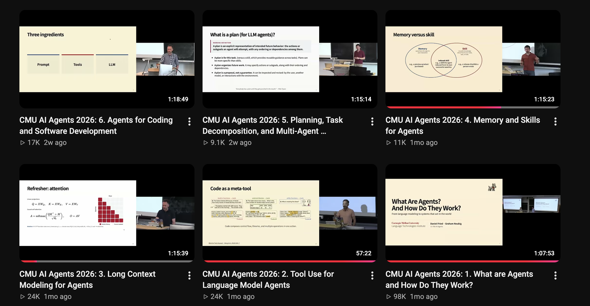
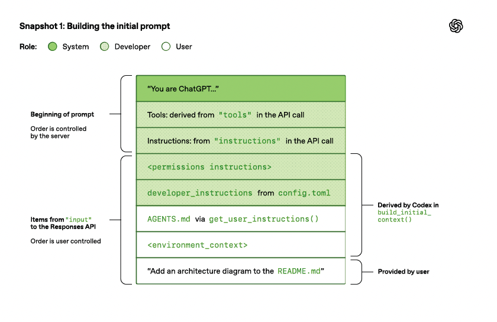
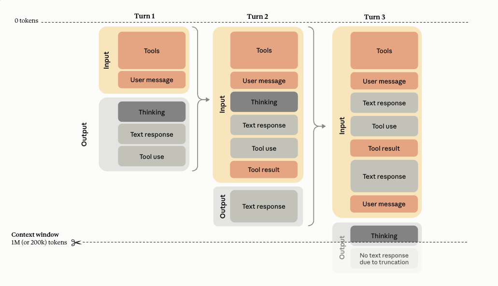
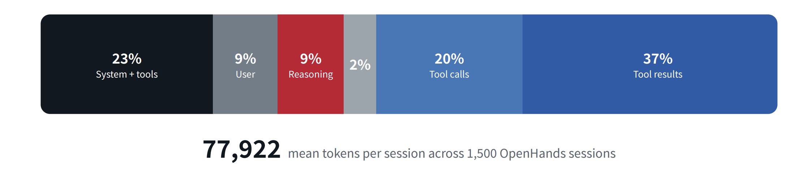
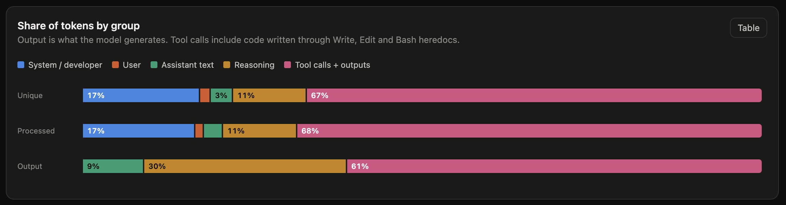
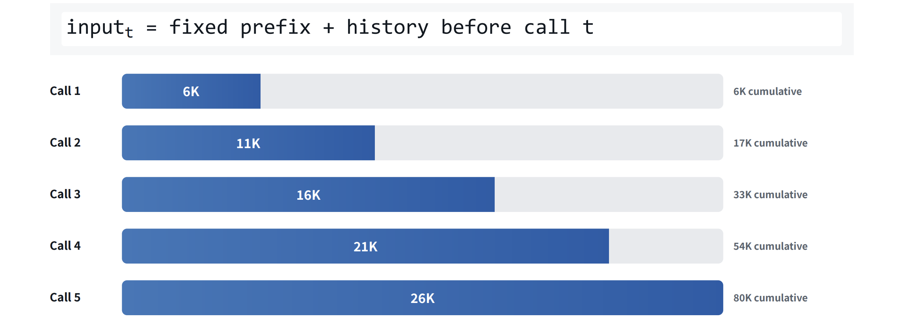
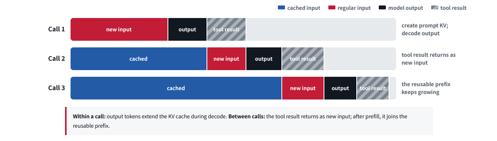
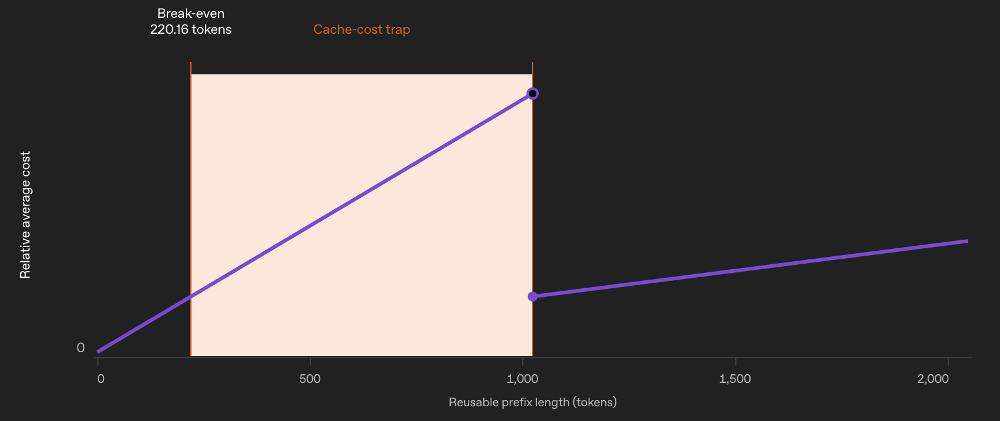
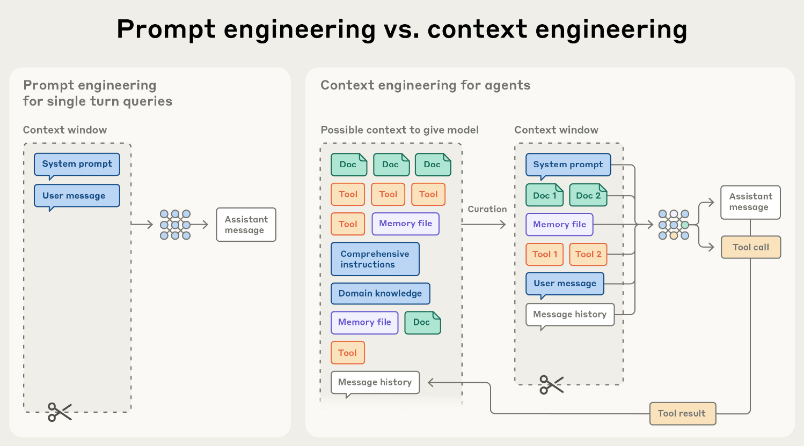
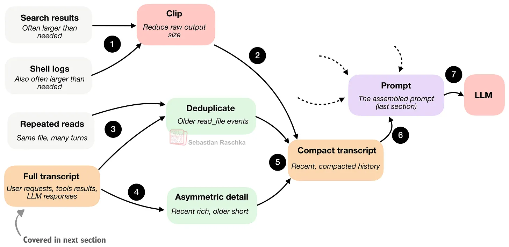

<!-- _class: title -->
<!-- _paginate: false -->

Agent Fight Club #4

Context Management

ANATOMY · ROT · CACHING · TECHNIQUES
AGENTFIGHTCLUB.TODAY

---

<!-- _class: repo -->

Clone the repos please

Deck &amp; Notes

https://github.com/maxsoldev/agent-meetup

Educodex Harness

https://github.com/maxsoldev/educodex

---

<!-- _class: watch big -->

## Agenda

1. Introduction round
2. Part 1: Theory of context management
3. Part 2: Build & Compete

---

## Introduction round

// 01

🙋

Who are you?

// 02

🎯

What do you expect from the event and community?

---

<!-- _class: roadmap -->

## Long-term agenda

01

Agent FoundationsAgent loop + basic tools

02

TodayContext ManagementAnatomy, context rot, caching, compaction

03

More harness featuresSkills, MCP, hooks

04

Agent memory &amp; searchRAG, web search

05

Self-improving agentse.g. Hermes, OpenClaw

06

Agent-to-Agent (A2A)Agentic commerce

07

AgentOpsObservability, evals

08

Dark factories &amp; the future of work

---

<!-- _class: bigtitle -->

Part 1

# Context Management

"A lot of apparent <strong>“model quality”</strong> is really context quality" — Sebastian Raschka

---

<!-- _class: agenda -->

## Agenda for today

1. Context Management Overview
   1. Context Anatomy: what is the context window and what goes in it
   2. Context Rot: why longer context hurts
   3. Caching: make-it-or-break-it for prod agents
   4. Context engineering techniques
   5. So what? Lessons for everyday interactions with agents
   6. Demo: custom educational harness based on codex
2. Workshop: manage context for trader agents

---

<!-- _class: sources -->

## Suggested sources

<strong>CMU 11-768 AI Agents 2026</strong> · Neubig &amp; Fried <a href="https://www.youtube.com/playlist?list=PLSN0qpDfUvTM">youtube.com/playlist?list=PLSN0qpDfUvTM</a>

- <a href="https://code.claude.com/docs/en/how-claude-code-works"><strong>How Claude Code works</strong>code.claude.com/docs/en/how-claude-code-works</a>
- <a href="https://manus.im/blog/Context-Engineering-for-AI-Agents-Lessons-from-Building-Manus"><strong>Manus: Context Engineering for AI Agents</strong>manus.im/blog</a>
- <a href="https://magazine.sebastianraschka.com/p/components-of-a-coding-agent"><strong>Raschka: Components of a Coding Agent</strong>magazine.sebastianraschka.com</a>
- <a href="https://blog.langchain.com/context-engineering-for-agents/"><strong>LangChain: Context Engineering for Agents</strong>blog.langchain.com/context-engineering-for-agents</a>

---

<!-- _class: loop -->

## Agent loop refresher

An agent is <strong>an LLM autonomously using tools in a loop</strong>— Simon Willison

---

<!-- _class: bigtitle -->

1.1

# Context Anatomy

What the model actually receives. Spoiler: <strong>far more</strong> than your prompts and tool results.

---

<!-- _class: plate white -->

## Initial prompt anatomy

---

<!-- _class: plate cream -->

## Context window

---

<!-- _class: anatomy -->

## Full context anatomy

1Base instructions

- Harness system prompt

2Tool definitions

- Built-in tools
- MCP tools

3Developer context

- Permissions
- Developer instructions, mode
- Skills: name + description
- Memories, plugins, apps

4User context

- AGENTS.md
- Environment: cwd, date, shell

5Conversation

- User messages
- Assistant messages
- Reasoning items
- Tool calls + outputs

6Injected mid-session

- Context updates
- Model switch, time, budget
- Hooks, subagents
- Compaction summary
- File-specific rules

7Hidden by provider

- Chat template tokens
- Tool schemas as text
- Provider system message

8Output

- Reply
- Reasoning tokens

---

<!-- _class: compo -->

## Where do the tokens go?

OpenHands1,500 sessions, mean 78K tokens

My Claude Code sessionsfrom ~/.claude/projects

Tool calls + results fill 57–68% of the window. Your prompt is a rounding error.

---

<!-- _class: tokenomics -->

## Tokenomics: agents pay to read, not to write

Token type · share of all task tokens

<b>53.9%</b>Input: prompts, tools, history

<b>21.6%</b>Reasoning

<b>24.4%</b>Output: code, text, tool calls

Stage · avg share of task tokens, when the stage ran

Code review
59.4%

Code completion

26.8%
6 of 30 tasks

Documentation
20.1%

Testing
10.3%

<strong>Coding</strong>
8.6%

Design
2.4%

Code review costs ~7× more tokens than writing the code

ChatDev multi-agent system, GPT-5, 30 tasks · <a href="https://arxiv.org/abs/2601.14470">Salim et al., Tokenomics, arXiv 2601.14470</a>

---

<!-- _class: compo -->

## Resend all previous input

Each call grows linearly → the total grows quadratically Every call resends the whole history: 6K + 11K + 16K + 21K + 26K = 80K after 5 calls

---

<!-- _class: bigtitle -->

Demo

# Educodex Context Demo

An educational harness based on Codex: see <strong>every token</strong> the model receives.

---

<!-- _class: bigtitle -->

1.2

# Context Rot

Why quality drops and latency grows with <strong>context length</strong>.

---

<!-- _class: pull -->

As context grows, the model gets worse at using&nbsp;it

A model that <strong>accepts</strong> 1M tokens doesn't <strong>use</strong> 1M tokens well. And every request gets slower and more expensive.

Context rot · Chroma, 2025 · Anthropic, 2025

---

<!-- _class: rot -->

## Why we want long context anyway

// 01

🏗️

Long tasks

- Migrations, large refactors
- Long autonomous runs
- Deep research

// 02

📚

Big inputs

- One big document
- Long media
- Many-shot examples

// 03

🧭

Unknown scope

- Hard, vague tasks
- You can't pick the context upfront

Some tasks need long context. So we must know what it costs

---

<!-- _class: rot -->

## The price of long context

The model gets worse

Each request gets slower and pricier

01

Worse quality

Weaker reasoning, repeated mistakes

02

Worse accuracy

Forgets instructions, mixes up facts

03

Slower

Long wait for the first word

04

More expensive

Bills grow faster than the session

Bad context makes 01 and 02 worse

<b>Poisoning</b>A hallucination keeps being referenced

<b>Distraction</b>The agent repeats past actions

<b>Confusion</b>Too many tools to choose from

<b>Clash</b>Parts of the context contradict each other

Drew Breunig, How Long Contexts Fail, 2025

---

<!-- _class: rot -->

## Why the model gets worse

// 01

🖍️

Fixed attention budget

Attention weights add up to 100%. More tokens = less for each. A highlighter with a fixed amount of ink.

// 02

📍

Position bias

Models favour the start and the end, whatever is there. The middle gets lost.

// 03

🏋️

Little practice

Long documents are rare in training data. Models can <strong>run</strong> at 1M tokens, not <strong>use</strong> them well.

Anthropic, Effective context engineering, 2025 · Liu et al., Lost in the Middle, 2023 · Neubig, CMU 11-768, 2026

---

<!-- _class: rot -->

## Context rot in numbers

QualityThe model gets worse

−14–85%

Scores drop from length alone, even if the extra tokens are whitespace

Du et al., 2025

99 → 70%

Retrieval at 32K when question and answer share no words

NoLiMa, 2025

68%

Best models follow only 68% of 500 instructions

IFScale, 2025

Cost100 steps, 20K prompt, +2K per step

10×

Step 100 costs 10× step 1

Illustrative

$36 → $4.4

No cache vs cache. Cheaper, but still quadratic

Claude API prices

3×

Fewer tokens: 5 fresh sessions of 20 steps vs one of 100

Illustrative

A long session costs more per step. Caching makes it cheaper, not better at scale

---

<!-- _class: watch big -->

## So what?

1. New task → new session. Compact or hand off with a short summary
2. Put what matters at the start or the end. Restate the goal (todo lists)
3. Correct early or start over. Don't argue with a poisoned context
4. Don't break the cache mid-session: same model, same tools

---

<!-- _class: bigtitle -->

1.3

# Caching

The rule everything else must respect. <strong>Make-it-or-break-it</strong> for prod agents.

---

<!-- _class: cache -->

## What is prompt caching?

"The KV-cache hit rate is the single most important metric for a production-stage AI agent"— Yichao Ji, Manus, 2025

What

Save the result of an expensive computation and reuse it, instead of computing it again.

The cache stores <strong>KV tensors</strong>, not the tokens.

How

Match the start of the request (the <u>prefix</u>) against recent requests

<b>Hit</b>Read the prefix from cache: ≤0.1× input price

<b>Miss</b>Compute it all, write to cache: 1.25× input price

---

<!-- _class: plate short -->

## Caching visualised

Each call reads the cached prefix and computes only the <strong>new</strong> part

Neubig, CMU 11-768, 2026 · Gim et al., Prompt Cache, MLSys 2024

---

<!-- _class: plate miss -->

## Cache miss: change the prefix, pay for everything again

A change anywhere <strong>invalidates everything after it</strong>, even content that did not change

---

<!-- _class: cache -->

## Why caching matters

10×

Cheaper

Cache reads cost 0.1× the input price (20× cheaper on Opus and Sonnet 5.5). A write costs 1.25×, so it pays off after one read

Claude &amp; OpenAI pricing

−67%

Faster

Time to first token: −7% at 1K tokens, −67% at 150K+. The longer the prompt, the bigger the win

OpenAI, Prompt Caching 201

5×

More throughput

Cache reads don't count toward Claude rate limits. 2M tokens/min limit + 80% hits = 10M tokens/min

Claude rate limits

0

Quality cost

Same model, same answer. Only the compute is reused

Anthropic, OpenAI

Real agent loops read a median 84% of input from cache. Below 80%? Something breaks it

Anthropic, Optimizing for cost and intelligence, 2026

---

<!-- _class: cache -->

## Three ways to cache

Implicit

Provider decides

The provider caches common prefixes. You change nothing. Best effort: no hit is guaranteed

OpenAI · Gemini

Breakpoints

You mark the prefix

A marker on a block: "cache everything up to here". The next request reads the longest entry that still matches. Usually up to 4 markers

Claude · Bedrock · OpenAI GPT-5.6+

Cache objects

You upload once

Upload the content, get a cache ID, refer to it later. You pay for storage per hour until the TTL ends

Gemini

Agents use the first two: a growing chat needs a prefix that moves forward

---

<!-- _class: cache -->

## What breaks the cache

The prefix changes

Everything after the change is computed again

- Edit the system prompt or an old message
- Add or remove tools: MCP server, plugin
- Compact the conversation
- Many images in the history
- Upgrade the harness

A different cache

Same prefix, but no cache for it yet

- Switch the model: each model has its own cache
- Change the effort level (fixed on GPT-6 and Claude 5.5, native API only)

Time runs out

The TTL counts from the start of the request

- Claude: 5 min, or 1 h for 2× the write price
- OpenAI GPT-6: 30 min
- Earlier OpenAI: 5–10 min, up to 24&nbsp;h extended

One model switch at 220K tokens ≈ 11 cached steps of cost

---

<!-- _class: plate trap -->

## Cache-cost trap: short prefixes are not cached

Below 1,024 tokens nothing is cached: a <strong>1,000-token</strong> prefix costs more than a <strong>2,000-token</strong> one

OpenAI, Prompt caching guide · minimum 1,024 tokens · read 0.1× · write 1.25× · 9 reads per write

---

<!-- _class: cache -->

## Best practices: append, don't edit

01 Stabilize the prefix

- Static first, dynamic last
- Pick model and effort at the start
- No tool changes mid-task

02 Append new state

- New info goes in new messages
- Rewind, don't argue: the old cache still works
- Compact at natural breaks

03 Keep it warm

- 1 h TTL if you pause often
- Pre-warm for low latency
- A 4-min answer leaves ~1 min of a 5-min TTL

04 Measure reuse

- Watch the cache hit rate
- Aim for 80%+
- A drop means something broke the prefix

Rule of thumb: append, don't edit. Pay for a cache break only at a natural break

---

<!-- _class: bigtitle -->

1.4

# Context Engineering

Not more information. The <strong>smallest set</strong> of high-signal tokens for the next step.

---

<!-- _class: ce -->

## What is context engineering?

Caching makes long context <strong>cheaper</strong>. Context engineering makes it <strong>smaller</strong>.

"Finding the smallest possible set of high-signal tokens that maximize the likelihood of some desired outcome"
— Anthropic

"The delicate art and science of filling the context window with just the right information for the next step"
— Andrej Karpathy

"The art of providing all the context for the task to be plausibly solvable by the LLM"
— Tobi Lütke, Shopify

<b>Prompt engineering</b>Tailor the input for <u>one</u> model response

→

<b>Context engineering</b>Build a system that gives the model the right information over <u>many</u> turns

---

<!-- _class: plate pce -->

Anthropic, Effective context engineering for AI agents, 2025

---

<!-- _class: ce -->

## Four moves of context engineering

// 01

✍️ Write

Save it outside the window, so it survives

- Notes and memory files
- Offload raw data to files
- Todo list (recitation)

<b>Loses</b> Freshness: memory goes stale

// 02

🎯 Select

Pull in only what the next step needs

- Just-in-time retrieval
- Progressive disclosure: skills, tool search, `--help`

<b>Loses</b> What the agent doesn't know to ask for

// 03

✂️ Compress

Fewer tokens for the same information

- Token-efficient tools
- Tool result clearing
- Compaction

<b>Loses</b> Details, and you can't see which

// 04

📦 Isolate

Do heavy work in another window

- Subagents
- Code execution sandbox

<b>Loses</b> The parent's context at the handoff

For any new agent feature, ask: which of the four is it, and what does it lose?

LangChain, Context Engineering for Agents, 2025 · Anthropic, Effective context engineering, 2025

---

<!-- _class: ce -->

// 01✍️ WriteSave it outside the window, so it survives

## Write: save context outside the window

A · Task memoryLives until the task is done

Problem: the goal gets lost in the middle. After compaction or in a new session, the agent starts with an empty head

- **Offload raw data** - big outputs go to disk, only a path stays. Restorable
- **Plan + recitation** - a todo list, updated each step, keeps the goal at the end of the context
- **Scratchpad** - findings and decisions as it works, e.g. `NOTES.md`
- **Handoff** - progress file + git + task list in JSON. `SPEC.md` for a fresh session

B · Long-term memoryLives across tasks

Problem: each session forgets what the last one learned

- **Human-written** - `AGENTS.md` / `CLAUDE.md`. Always loaded, so keep it short
- **Agent-written during work** - the agent decides to save a fact. Claude Code auto memory, ChatGPT memory
- **Consolidated offline ("dreaming")** - a background job reads old sessions and merges them. Codex memories

What Write costs

<b>Read back</b>A note helps only if it is read at the right time. That is a Select question

<b>Stale</b>Wrong memory = poisoning that persists across sessions

<b>Leaks</b>Memory can leak into unrelated tasks

<b>Who writes</b>Agent: spends attention mid-task. Offline job: free, but arrives late

Manus, 2025 · Anthropic, Effective harnesses for long-running agents, 2025 · LangChain, 2025

---

<!-- _class: ce -->

## Write: two ways to remember

📝 Claude Code auto memoryNotes during the day

- **Who writes** - the main agent, during the session, with its file tools
- **At start** - first 200 lines or 25 KB of `MEMORY.md`, the index
- **On demand** - topic files, read with file tools
- **Scope** - per git repo. On by default

🌙 Codex memoriesA diary written at night

- **Who writes** - a background job: one LLM call per idle session (6 h+), then a sub-agent merges the notes
- **At start** - `memory_summary.md`, cut to 2,500 tokens
- **On demand** - grep `MEMORY.md` and rollout summaries
- **Scope** - global per user. Off by default

Kinds of memory

Semantic

Facts: "user prefers uv", project structure

Episodic

Past experiences: "last time this test failed because…"

Procedural

How to do things: AGENTS.md rules, skills

Both use the same trick: a small index upfront, details on demand

CoALA, Sumers et al., 2023 · Claude Code memory docs · Codex source

---

<!-- _class: ce -->

// 02🎯 SelectPull in only what the next step needs

## Select: who picks the context, and when

A · UpfrontThe harness selects before the call

- **Always loaded** - system prompt, AGENTS.md, skill metadata, `@file`
- **Classic RAG** - top-k chunks in the prompt. The model can't ask for more
- **Tool loadout** - pick tools per task. Tool choice gets confused above ~30 tools

B · On demandThe agent selects at runtime

- **Agentic search** - grep, glob, read ranges. Claude Code: grep beat vector DBs
- **Semantic search as a tool** - Cursor: +12.5% accuracy on top of grep
- **Progressive disclosure** - small index always loaded, details on demand

C · HybridMost real agents

- Claude Code loads CLAUDE.md upfront and greps for the rest
- Upfront fits content that changes less often, e.g. legal or finance

What Select costs

<b>Slower</b>On demand = more turns, and each result adds tokens

<b>Unknown unknowns</b>A weak skill or tool description = never loaded

<b>Noise</b>Wrong chunks distract. Stale indexes give old code

<b>Cache</b>Changing loaded tools breaks it. Mask, don't remove

Anthropic, 2025 · Pragmatic Engineer, Building Claude Code, 2026 · Cursor, Semantic search, 2025 · Drew Breunig, 2025 · Manus, 2025

---

<!-- _class: ce -->

## Select: two axes, one pattern

Keyword / structure: grep, paths

Semantic: embeddings

Upfrontharness

<b>AGENTS.md, @file</b>Always there, cheap, predictable

<b>Classic RAG</b>Embed the query, top-k chunks

On demandagent

<b>Claude Code, Codex</b>grep / glob / read, refine the query

<b>Cursor semantic search tool</b>Same embeddings, the agent decides when

Progressive disclosure: the same pattern in three places

Skills

name + description

→

SKILL.md body

→

bundled files

Tools

tool search stub

→

full definition (−85% tokens)

→

CLI <code>--help</code>, MCP as code files

Memory

memory_summary.md

→

grep MEMORY.md

→

rollout summaries

---

<!-- _class: ce -->

// 03✂️ CompressFewer tokens for the same information

## Compress: where we cut

A · At the sourceBefore tokens enter the context

- **Token-efficient tools** - pagination, filters, truncation. Claude Code caps tool output at 25K tokens
- **Output filters** - RTK: failures only, short `git status`. 60–90% less bash output
- **Terse model output** - Caveman, "80% of ASD-STE100". DIY, weak evidence

B · DiscardIn the history, no LLM

- **Tool result clearing** (observation masking) - replace old outputs with a placeholder, keep the call
- Same for old thinking blocks
- Restorable, if the output was offloaded to a file (Write)

C · CondenseIn the history, LLM, lossy

- **Compaction** - summarise the history, start a new window with the summary
- **Claude Code** keeps decisions, open bugs, 5 recent files. Steer with `/compact <focus>`
- **Codex** gets an encrypted item from the server. You can't read what it kept

<b>Hybrid</b>Mask first, summarise only when masking is not enough: −7% cost vs masking, −11% vs summary

Anthropic, Writing tools for agents, 2025 · RTK · JetBrains, The Complexity Trap, NeurIPS 2025 · Claude Code docs · OpenAI Compaction docs

---

<!-- _class: plate short -->

## Compress: a pipeline, not one summary

Clip big outputs, drop repeated reads, keep <strong>recent detail rich</strong> and older detail short

Sebastian Raschka, Components of a Coding Agent

---

<!-- _class: ce -->

## Compress: simple beats clever

½ cost

Observation masking vs LLM summary. Same solve rate

JetBrains, NeurIPS 2025

−84%

Tokens in a 100-turn eval with context editing, +29% on agentic search

Anthropic, 2025

0 LLM calls

Masking is free. Summary costs a call and a buffer in the window

Claude Code, 2026

Never removeWhat the next step needs

- **Errors and stack traces** - so the agent doesn't repeat them
- **The plan / todo list** and the user's instructions
- **The last N tool results** - the fresh tail

What Compress costsLossy and cache-breaking

- **Lost details** - you can't see which. Back only if raw data is on disk
- **New prefix** - after compaction, only system prompt and tools stay cached
- **Clearing breaks the cache** - so clear in big chunks (`clear_at_least`)
- **Summary call** - use a cache-safe fork: same prefix + compaction prompt

Start with masking. Summarise only when you can measure the gain

---

<!-- _class: ce -->

// 04📦 IsolateDo heavy work in another window

## Isolate: subagents

"The essence of search is compression": read tens of thousands of tokens, return 1–2K— Anthropic, multi-agent research

// 01

🔎 Explorer (read-only)

- Reads a lot, returns a summary
- Claude Code Explore on Haiku
- Lead + subagents beat one Opus by 90%

// 02

🧐 Clean reviewer

- Never saw the build: no bias
- Coder and reviewer share no context

// 03

⚡ Parallel workers

- Independent subtasks at once
- Up to 90% faster research
- Writes stay single-threaded

// 04

🔀 Another model

- A model switch breaks the cache
- Use a subagent with a handoff

Design knobs

<b>Context in</b>Fresh brief (goal, output format, tools, limits) or fork of the parent: shares the cache

<b>Context out</b>Summary, or files + a reference back. Avoid the "game of telephone"

<b>Permissions</b>Read-only is the safe default

Anthropic, How we built our multi-agent research system, 2025 · Cognition, Multi-Agents: What's Actually Working, 2026 · Thariq Shihipar, 2026

---

<!-- _class: ce -->

## Isolate: code execution, and the price

Outside the LLM: the agent writes a script, only the final output enters the context

150K → 2K

Tokens with MCP tools as code files

Anthropic, 2025

−37%

Tokens with programmatic tool calling

Anthropic, 2025

+8%

Cost for strictly sequential calls (τ²-bench). No fan-out, no gain

Claude API docs

What Isolate costs

4× / 15×

Tokens: agents vs chat, multi-agent vs chat

Anthropic, 2025

Handoff

The subagent doesn't see the parent. The parent sees only the summary

Coding

"Fewer truly parallelizable tasks than research"

Overhead

Container start, script writing. Pays off only with fan-out or big results

Isolate when the work is heavy, parallel or valuable. Else stay in one window

---

<!-- _class: ce -->

## Constraint for all four: the cache

| Technique                 | Cache effect                               | Cache-friendly way                                  |
| ------------------------- | ------------------------------------------ | --------------------------------------------------- |
| Write: notes, todo        | None, appended as new messages             | Updates go in messages, not in the system prompt    |
| Select: add/remove tools  | Breaks all of it, tools are near the start | Mask, don't remove. Tool search with deferred stubs |
| Select: on-demand loading | None, results are appended                 | -                                                   |
| Compress: clearing        | Breaks from the first cleared result       | Clear in big chunks (`clear_at_least`)              |
| Compress: compaction      | New history = new prefix                   | Cache-safe fork for the summary call                |
| Isolate: subagent         | Fresh brief = its own new cache            | Fork shares the parent's prefix                     |
| Isolate: another model    | Each model has its own cache               | Subagent with a handoff, not a mid-session switch   |

Append, don't edit. Pay for a cache break only when it removes many tokens

Manus, 2025 · Claude API, Context editing · Thariq Shihipar, Prompt caching is everything, 2026

---

<!-- _class: tk -->

## Takeaways

If you keep only oneThe context window is the agent's working memory. Everything in it costs money, time and attention, so put in only what the next step needs

01

The model sees far more than you typed, on every call

→ Run <code>/context</code> once and look

02

More context isn't free: worse answers, quadratic cost

→ 1M is a limit, not a target

03

Caching is the rule everything else must respect

→ Same model, same tools. Append, don't edit

04

Context engineering = smallest set of high-signal tokens

→ For each token: does the next step need it?

05

Four moves: Write, Select, Compress, Isolate

→ For any new feature: which of the four is it?

06

Simple beats clever: masking, grep, a todo file

→ Add complexity only when you can measure it

07

Every technique throws something away

→ Keep spec, progress and notes on disk

---

<!-- _class: closing -->

End of Part 1

# Q&amp;A

---

<!-- _class: bigtitle -->

Part 2

# Workshop

Build &amp; compete: <strong>manage context</strong> for trader agents.

